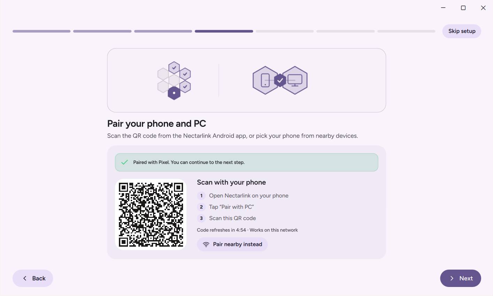
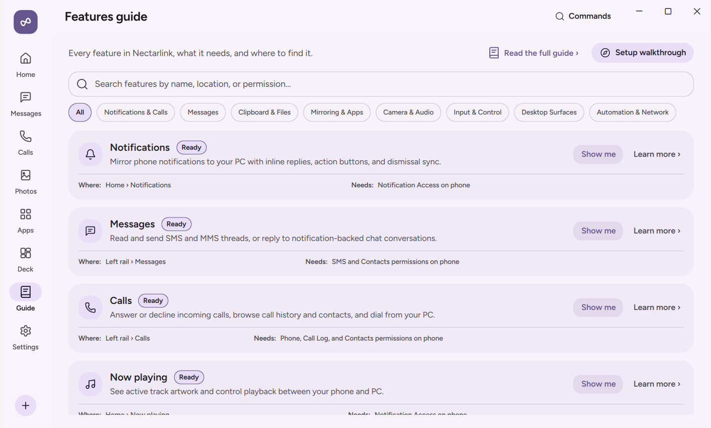
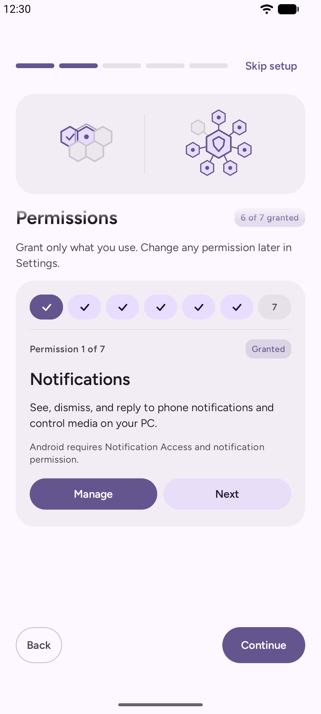
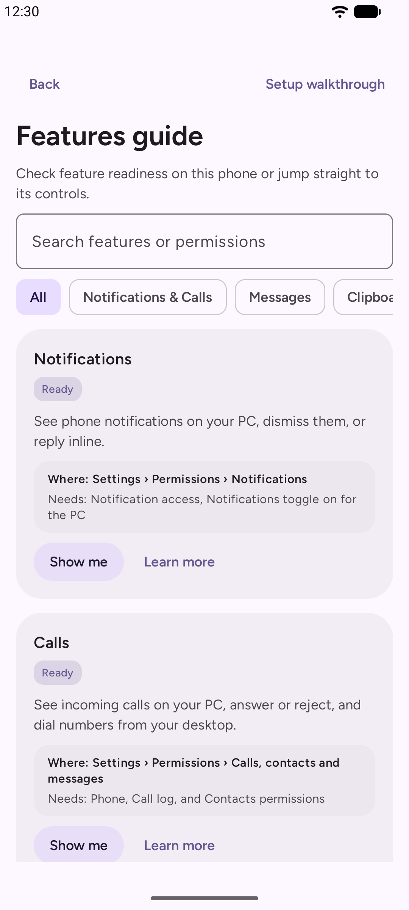
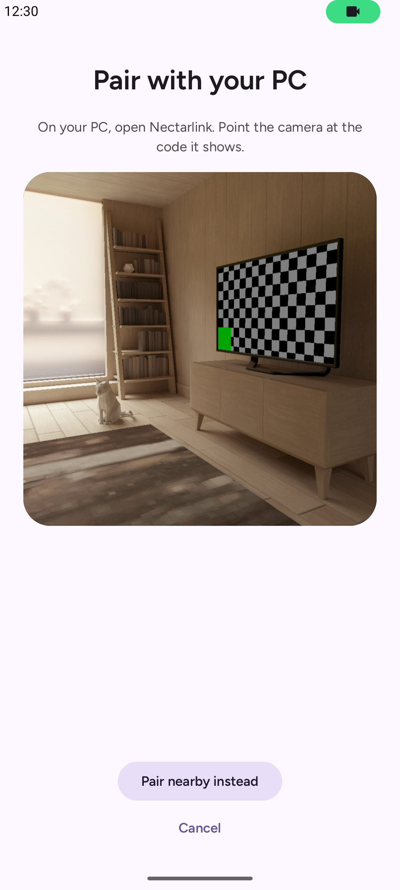
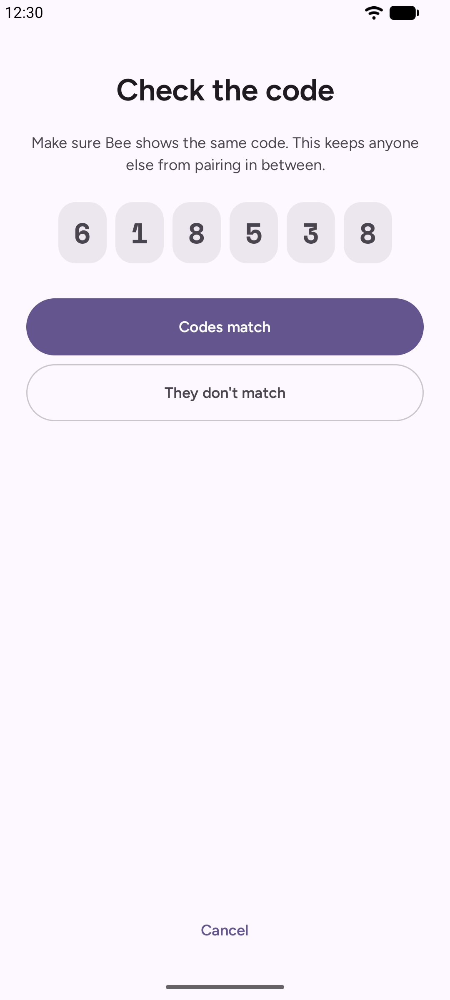
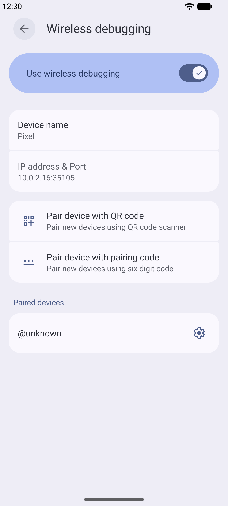

# Getting Started

This guide walks you through setting up Honeycomb on macOS and Android, completing the first-run setup walkthrough, pairing your devices, and choosing the Android integration level.

## System Requirements

| Platform | Minimum Version | Notes |
| :--- | :--- | :--- |
| **macOS (Desktop)** | macOS 14+ (Sonoma, Sequoia) on Apple Silicon (M1/M2/M3/M4) or Intel | Hardware H.264 decoding via VideoToolbox, NSPasteboard clipboard sync, CoreAudio, and AppleScript notification dispatch. |
| **Android Phone or Tablet** | Android 8.0 (API 26) or newer | Android 10+ required for internal audio capture during mirroring; Android 11+ required for on-device Wireless Debugging (`Elevated`); Android 12+ required for `Elevated` in-call mute/hold controls. |
| **Network** | Shared Wi-Fi / LAN, or direct USB cable | By default, all device-to-device traffic travels directly over your local network or a USB data cable without leaving your LAN via mutual TLS 1.3 over QUIC. |

## Installing & Running Honeycomb

### On macOS

1. Build or install the desktop application (see [doc/MACOS_BUILD.md](../../doc/MACOS_BUILD.md)):
   ```sh
   export PATH="$HOME/.cargo/bin:/opt/homebrew/opt/qt/bin:$PATH"
   export QMAKE=/opt/homebrew/opt/qt/bin/qmake
   cargo build --release -p honeycomb-desktop
   ```
2. Launch the application:
   ```sh
   ./target/release/honeycomb-desktop
   ```
   Or open `Honeycomb.app` from your Applications folder if packaged.
3. On first launch, macOS may prompt for **Local Network** permissions: approve it so Honeycomb can discover paired devices via mDNS.

### On Android

1. Build or download the Android APK (see [doc/ANDROID_BUILD.md](../../doc/ANDROID_BUILD.md)):
   ```sh
   cd android && ./gradlew assembleDebug
   ```
2. Install via ADB from your Mac or transfer the APK:
   ```sh
   adb install -r android/app/build/outputs/apk/debug/app-debug.apk
   ```
3. Open **Honeycomb** on your phone.

### Uninstalling

- **macOS:** Quit the application and delete `~/Library/Application Support/Honeycomb` to clear saved pairings and settings.
- **Android:** Uninstall the Honeycomb app from Android settings.

## First-Run Setup Walkthrough

When you open Honeycomb for the first time on a new installation, a guided walkthrough sets up your device in a few short steps. You can go back or skip any optional step, and if you close the app midway, it resumes where you left off. You can also reopen the walkthrough at any time from **Settings › Connection & About** on Windows or **Settings › Features & Data › About** on Android.

### PC Walkthrough Steps

<p align="center">
  
</p>

1. **Welcome**: Introduces Honeycomb and how your phone and PC work together.
2. **Privacy Promise**: Summarizes Honeycomb's local-first design: direct connections on your network, end-to-end encryption with device keys, and no user account or cloud server.
3. **Install the Phone App**: Shows a scannable QR code linking directly to the Android APK if you do not have it installed yet.
4. **Pair**: Displays your PC's live pairing QR code and listens for nearby phones or USB connections.
5. **Choose What to Share**: Lets you review the main per-device feature toggles (Notifications, Messages, Calls, Clipboard, Files, Photos, Screen mirroring, Webcam) before your first session begins.
6. **Optional PC Setup**: Checks Windows notification permission, the **Start with Windows** toggle, and your firewall rules through the `Connection Doctor`.
7. **Done**: Opens the in-app **Features Guide**, which shows every feature, its live availability for your paired phone, and a **Show me** button that navigates straight to each control.

<p align="center">
  
</p>

### Android Walkthrough Steps

<p align="center">
  
  
</p>

1. **Welcome**: Introduces the companion app.
2. **Permissions**: Requests only the permissions you want to use, one at a time, with a plain explanation of why each is needed:
   - **Notifications**: Lets Honeycomb mirror phone notifications to your PC and run inline replies or actions.
   - **SMS and MMS**: Lets you read conversations and send texts from your PC.
   - **Calls and Call Log**: Shows caller ID, recent calls, and call controls on your PC.
   - **Contacts**: Matches phone numbers to names and photos in Calls and Messages on your PC.
   - **Photos and Videos**: Displays your camera roll and new screenshots on your PC.
   - **Stay Reachable in the Background**: Exempts Honeycomb from Android's aggressive background battery killer so your PC can always reach your phone.
   - **Local Network**: Allows discovery and direct QUIC connections to your PC.
3. **Pair**: Scans the QR code shown on your PC or connects using a 6-digit nearby code.
4. **Choose a Power Level**: Explains `Standard`, `Assist`, and `Elevated` so you can pick the level of integration you prefer.
5. **Done**: Takes you to the Home screen and links to the in-app **Features Guide**.

> **Note on Android 13 and newer ("Restricted settings")**: When you install an APK outside an app store on Android 13 or newer, Android initially grays out the **Notification access** and **Accessibility** switches as a security precaution. If a switch is grayed out, tap **App info** inside Honeycomb's prompt (or open Android's **Settings › Apps › Honeycomb**), tap the three-dot menu in the top-right corner, tap **Allow restricted settings**, verify with your screen lock, and return to Honeycomb.

## Pairing Your Phone and PC

Honeycomb supports three ways to `pair` your phone and PC. All three methods establish the same mutual Ed25519 cryptographic trust and end-to-end encrypted QUIC session.

<p align="center">
  
</p>

### Method 1: Scan the QR Code (Fastest on Wi-Fi)

1. On your PC, open Honeycomb. If no phone is paired yet, the pairing screen opens automatically. Otherwise, go to **Settings › Devices** and click **Pair a new device**.
2. On your phone, open Honeycomb and tap **Scan code** (or point your phone's built-in camera app at the QR code on the PC screen).
3. The QR code contains your PC's public key, local IP addresses, and a one-time 128-bit cryptographic secret (`s`) that expires after 5 minutes. Both devices verify the HMAC-SHA256 proof and complete pairing immediately.

### Method 2: 6-Digit Nearby Code (No Camera Needed)

1. Make sure both your phone and PC are on the same Wi-Fi or local network.
2. Open the pairing screen in Honeycomb on your PC.
3. On your phone, tap **Pair nearby instead** and select your PC's name from the discovered list.
4. Both screens display a 6-digit verification code derived via HMAC-SHA256 from both devices' committed random nonces and Ed25519 public keys over the TLS 1.3 pairing session.
5. Verify that the 6 digits match on both screens, then click **Codes match** on the PC and tap **Codes match** on the phone. If the numbers do not match, tap **They don't match** to abort the connection.

### Method 3: Plug in a USB Cable (Auto-Pair)

If you have USB debugging (`adb`) enabled on your phone, Honeycomb detects the phone as soon as you plug it into your PC with a USB cable.

<p align="center">
  
</p>

1. Connect your phone to your PC with a USB data cable and approve the Android **Allow USB debugging** prompt on your phone if asked.
2. Honeycomb sets up a local loopback tunnel over USB and automatically opens the 6-digit confirmation prompt on both the PC and the phone.
3. Confirm that the 6-digit code matches on both screens and accept on both devices.
4. Once paired, Honeycomb uses the high-speed USB connection (`On USB`) whenever the cable is plugged in and switches to Wi-Fi automatically when you unplug it.

## Choosing an Android Power Level

Android groups app capabilities into tiers of system access. Honeycomb is designed so that everyday features work out of the box at the `Standard` level, while power users can opt into `Assist` or `Elevated` without rooting their phone.

### Comparison of Power Levels

| Feature or Capability | `Standard` (Default) | `Assist` (Accessibility) | `Elevated` (Wireless Debugging / ADB) |
| :--- | :--- | :--- | :--- |
| **Setup required** | Ordinary Android permissions | Turn on Honeycomb in Android Accessibility | One-time Wireless Debugging pairing on phone (or USB `adb`) |
| **Notifications, inline reply, actions, dismiss sync** | Yes | Yes | Yes |
| **Sensitive notification text & OTPs on Android 15+** | Hidden by Android OS | Hidden by Android OS | **Enabled** (`RECEIVE_SENSITIVE_NOTIFICATIONS`) |
| **SMS, MMS, Unified Conversations, Calls, Contacts, Photos** | Yes | Yes | Yes |
| **File transfers, Folder sync, Phone storage in Explorer** | Yes | Yes | Yes |
| **PC-to-phone clipboard sync** | Automatic | Automatic | Automatic |
| **Phone-to-PC clipboard sync** | Manual (Quick Settings tile, share sheet, or app button) | Manual (Quick Settings tile, share sheet, or app button) | **Automatic in the background** |
| **Screen mirroring (view video & audio on PC)** | Yes (Android prompts each time) | Yes (Android prompts each time) | **Prompt-free startup** (`PROJECT_MEDIA` granted automatically) |
| **Control phone from PC mouse & keyboard during mirroring** | View-only | Tap, swipe, scroll, basic text entry | **Real-time touch dragging, UHID physical keyboard layouts, XInput gamepad, stylus pressure/tilt** |
| **Turn off physical phone screen while mirroring** | No | No | **Yes** |
| **Phone apps in individual PC windows (`app window`)** | No | No | **Yes** (Android 11+) |
| **In-call mute, hold, speakerphone & keypad from PC** | Answer, decline, hang up, volume | Answer, decline, hang up, volume | **Yes** (Android 12+) |
| **Phone controls on PC Home** | Volume, ringer mode, flashlight (plus DND and brightness with their settings toggles) | Same as `Standard` | **Adds Wi-Fi and Bluetooth toggles** (and auto-grants DND and brightness permissions) |

### Trade-Offs to Know

- **`Standard`** requires the least setup and grants Honeycomb zero input-injection or shell capabilities. Its only limits come from Android OS rules: background apps cannot read the clipboard automatically, Android shows a confirmation dialog each time screen mirroring starts, and mirroring is view-only.
- **`Assist`** takes about 30 seconds to turn on in **Android Settings › Accessibility › Honeycomb: control from your PC**. It lets your PC mouse and keyboard tap, swipe, and type on the mirrored screen. Because Android's Accessibility gesture API dispatches completed strokes rather than live pointer streams, dragging (such as long-press drag-and-drop) is discrete rather than continuous.
- **`Elevated`** runs a small, open-source companion process (`app.honeycomb.android.elevated.InputServer`) inside Android's `shell` user (`UID 2000`) via Android's built-in Wireless Debugging. It gives Honeycomb the same capabilities as desktop `scrcpy`, plus background clipboard sync and `app window` streaming, without needing a PC cable or root. Only Honeycomb's own app process (presenting the one-time 192-bit session token over loopback) can talk to the helper.

### How to Enable `Elevated` on Your Phone (Wireless Debugging)

You can set up `Elevated` directly on your phone in about two minutes on Android 11 or newer:

<p align="center">
  
</p>

1. Open **Honeycomb** on your phone and go to **Settings › Permissions › Control from your PC**.
2. Next to **Real touch and keys (Wireless debugging)**, tap **Set up**.
3. If **Developer options** is not enabled on your phone yet, open Android's **Settings › About phone** and tap **Build number** 7 times until Android confirms you are a developer.
4. Tap **Open Developer options** in Honeycomb. Scroll down to **Wireless debugging**, turn the switch **On**, and tap the words **Wireless debugging** to open its sub-screen.
5. Tap **Pair device with pairing code**. A dialog appears showing a 6-digit Wi-Fi pairing code.
6. Do not close that dialog. Pull down the notification shade at the top of your screen, find Honeycomb's **Pair Honeycomb with Wireless debugging** notification, tap **Enter code**, type the 6-digit code, and send it.
7. Honeycomb pairs with Wireless Debugging and starts the `Elevated` helper immediately. After this one-time pairing, Honeycomb automatically restarts `Elevated` in the background whenever you reconnect to Wi-Fi or reboot your phone.

### Alternative: Automatic `Elevated` via USB Cable

If you connect your phone to your PC with a USB cable and have **USB debugging** enabled in Developer options, Honeycomb on your PC can start the `Elevated` helper on your phone over `adb` automatically without needing the Wi-Fi pairing code step.
